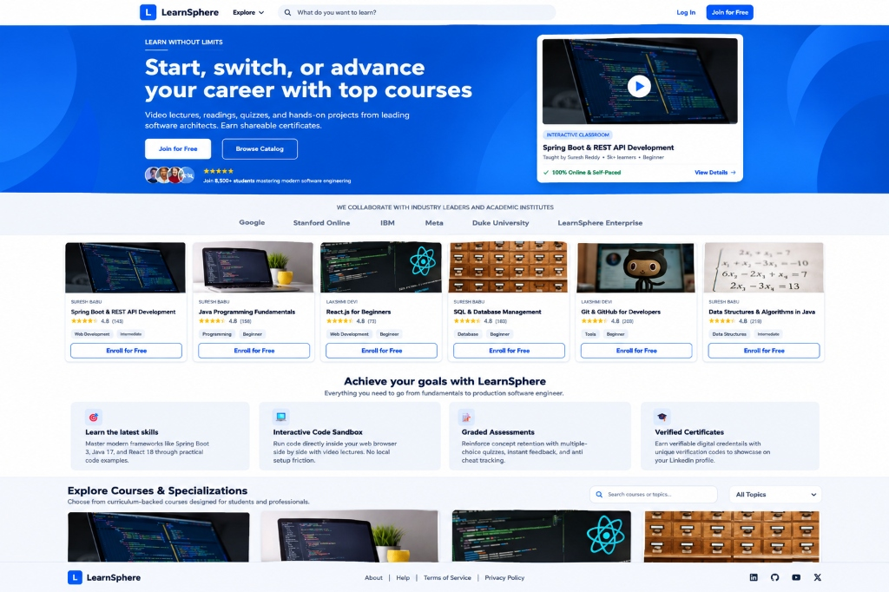
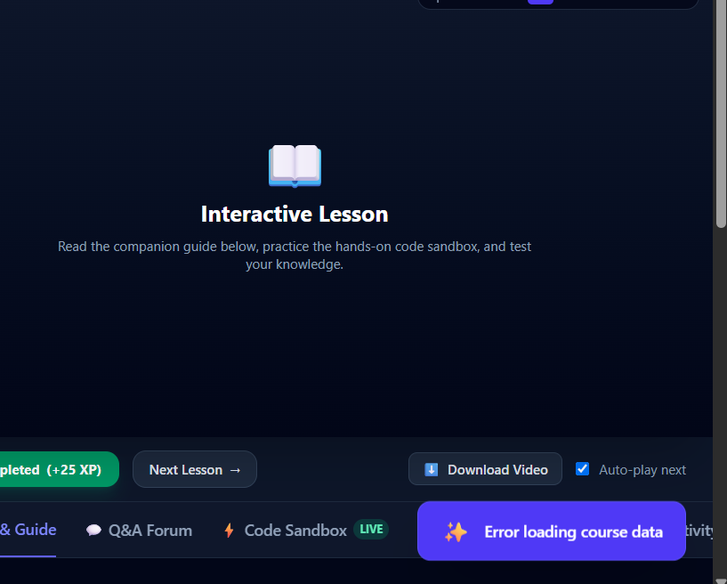
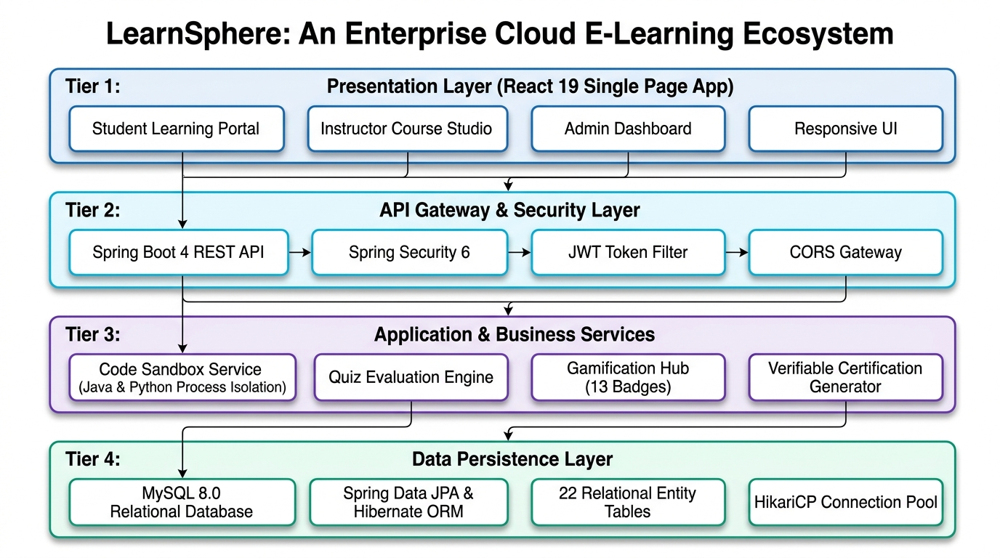
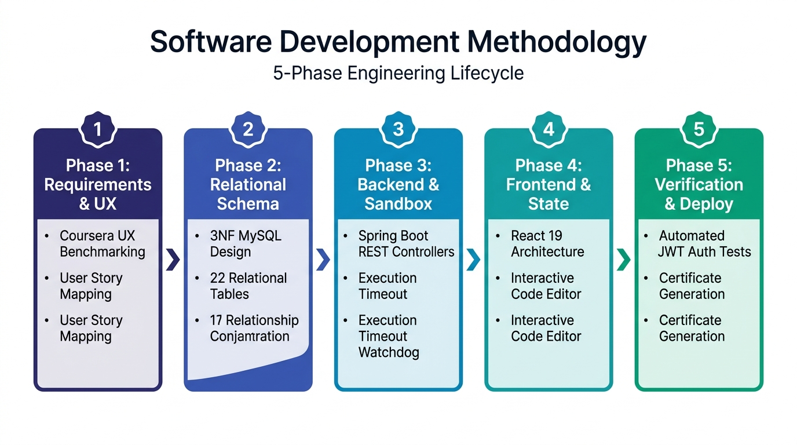

<div align="center">

# 🎓 LearnSphere — Enterprise E-Learning Management Platform

[](https://learnsphere-frontend-tz2j.onrender.com/)
[](https://react.dev/)
[](https://spring.io/projects/spring-boot)
[](https://www.oracle.com/java/)
[](https://www.mysql.com/)
[](LICENSE)

<p align="center">
  A production-ready, Coursera-style full-stack digital learning ecosystem engineered with <b>Spring Boot 4</b>, <b>React 19</b>, and <b>MySQL</b>. Featuring role-based portals (Student, Instructor, Administrator), modular video lecture streaming, automated quiz evaluations, verifiable certificates, and real-time student notifications.
</p>

[**Explore Live Web Application 🚀**](https://learnsphere-frontend-tz2j.onrender.com/) • [**Backend REST API 📡**](https://learnsphere-backend-xm9f.onrender.com/api/courses) • [**Report an Issue 🐛**](https://github.com/kharshitha15/learnsphere-platform/issues)

<br/><br/>



</div>

---

## 🌐 Live Cloud Deployments

| Component | Cloud Host | Live URL | Health Status |
| :--- | :--- | :--- | :--- |
| **Frontend Web App** | Render Static CDN | [https://learnsphere-frontend-tz2j.onrender.com/](https://learnsphere-frontend-tz2j.onrender.com/) |  |
| **Backend REST API** | Render Docker Web Service | [https://learnsphere-backend-xm9f.onrender.com/api/courses](https://learnsphere-backend-xm9f.onrender.com/api/courses) |  |
| **GitHub Repository** | GitHub | [kharshitha15/learnsphere-platform](https://github.com/kharshitha15/learnsphere-platform) |  |

---

## 🔑 Demo Access Credentials

Test the platform across different roles with pre-configured demo accounts:

| Role | Email Address | Password | Permissions & Available Features |
| :--- | :--- | :--- | :--- |
| 🧑‍🎓 **Student** | `ravi.kumar@example.com` | `NewPassword@123` | Browse catalog, enroll in courses, stream video lectures, take assessments, view quiz results, track progress, download completion certificates. |
| 👨‍🏫 **Instructor** | `suresh.babu@example.com` | `NewPassword@123` | Instructor Hub, create & manage courses, publish video modules, design quizzes, monitor enrolled student statistics. |
| 🛡️ **Administrator** | `admin@example.com` | `NewPassword@123` | Platform oversight, student & instructor user moderation, course verification & publishing control, global system statistics. |

---

## 📸 Application Showcase

<div align="center">

### 1. Modern Course Discovery & Learning Marketplace

*Comprehensive course catalog with category filters, enrolled student metrics, and instant course discovery.*

<br/>

### 2. Interactive Video Learning Player

*Full-featured learning player with modular topic navigation, video playback, lesson notes, and curriculum outline.*

<br/>

### 3. Integrated Assessment & Quiz Engine

*Interactive multiple-choice assessment engine with real-time feedback, question explanations, and automated score computation.*

</div>

---

## 🏗️ System Architecture & Engineering

LearnSphere is designed following enterprise **3-Tier layered architecture** patterns, emphasizing loose coupling, high cohesion, and stateless horizontal scalability.

<div align="center">
  
</div>

### Architectural Highlights:
1. **Presentation Layer (React 19 + Vite + Tailwind CSS)**:
   - Single Page Application (SPA) architecture with React Router v6.
   - Axios client with automated JWT Bearer request interceptors and centralized error handling.
   - Mobile-first responsive UI built with Tailwind CSS.
2. **Security & API Gateway (Spring Security + JWT)**:
   - Stateless authentication filter (`JwtAuthenticationFilter`) validating cryptographic tokens on every request.
   - Role-Based Access Control (`STUDENT`, `INSTRUCTOR`, `ADMIN`) guarding specific REST endpoints.
   - Dynamic CORS filter enabling secure cross-origin communication between cloud-hosted frontend and API services.
3. **Application & Business Logic Layer (Spring Boot 4)**:
   - Controller-Service-Repository design pattern.
   - Declarative transaction boundaries (`@Transactional`) for data integrity during course enrollments and grading.
4. **Data Persistence Layer (Spring Data JPA / Hibernate + MySQL 8.0)**:
   - Fully normalized relational schema with indexing on foreign keys (`userId`, `courseId`).
   - Automated cloud fallback to embedded storage (`H2` in MySQL compatibility mode) for zero-downtime serverless deployments.

---

## 🔄 Software Development Methodology

The project was executed following the **Iterative Agile-Scrum Methodology**, divided into structured sprints from requirements elicitation to automated cloud deployment:

<div align="center">
  
</div>

---

## ✨ Core Features & Functional Modules

### 🎓 1. Student Learning Experience
- **Course Marketplace**: Explore courses filtered by Category (Web Development, Data Structures, Databases, Tools) and Difficulty (Beginner, Intermediate, Advanced).
- **Curriculum Navigation**: Hierarchical progression through Courses $\rightarrow$ Modules $\rightarrow$ Video Lessons.
- **Real-Time Notification Center**: Instant alerts for course updates, newly unlocked assessments, and graded achievements.
- **Smart Progress Persistence**: Real-time tracking of completed lessons with dynamic percentage calculations.
- **Verified Certificates**: Automated generation of completion certificates upon finishing 100% of curriculum content and passing all quizzes.

### 👨‍🏫 2. Instructor Studio
- **Course Authoring**: Dynamic creation of curriculum outlines, lesson video uploads, and descriptive metadata.
- **Assessment Builder**: Custom quiz designer with variable answer choices, answer keys, and passing thresholds.
- **Student Performance Metrics**: Enrollment analytics and submission summaries.

### 🛡️ 3. Administrative Control & Security
- **Role-Based Guards**: Strict path-based permission policies.
- **Account Danger Zone**: Self-service student account deactivation and data purging compliant with privacy norms.
- **Audit Monitoring**: System-wide health checks and user role auditing.

---

## 💻 Tech Stack & Dependencies

```
├── Frontend (Client Tier)
│   ├── React 19 (Component-driven UI architecture)
│   ├── Vite 8.3 (High-performance build tooling & bundling)
│   ├── Tailwind CSS (Utility-first responsive design system)
│   ├── Lucide React (Enterprise icon system)
│   └── Axios (Promise-based HTTP client with JWT interceptors)
│
├── Backend (Service Tier)
│   ├── Java 21 (Modern LTS Java runtime)
│   ├── Spring Boot 4.1.1 (Microservice & REST framework)
│   ├── Spring Security (Stateless authentication & RBAC)
│   ├── Spring Data JPA (Object-relational mapping & queries)
│   ├── Hibernate (ORM persistence engine)
│   └── JJWT 0.11.5 (JSON Web Token signing and parsing)
│
├── Data Tier (Persistence)
│   ├── MySQL 8.0 (Primary production relational database)
│   └── H2 Database (In-memory / file-based cloud fallback)
│
└── DevOps & Infrastructure
    ├── Docker (Multi-stage containerization)
    ├── Render (Cloud hosting with continuous deployment)
    └── Git / GitHub (Version control & release management)
```

---

## 🚀 Local Development Setup

### Prerequisites
- **JDK 21** or higher installed ([Download JDK 21](https://www.oracle.com/java/technologies/downloads/))
- **Node.js 18+** & **npm** installed ([Download Node.js](https://nodejs.org/))
- **MySQL Server 8.0+** running locally (Port 3306)

---

### Step 1: Clone Repository
```bash
git clone https://github.com/kharshitha15/learnsphere-platform.git
cd learnsphere-platform
```

### Step 2: Configure & Start MySQL
Create the database in your local MySQL instance:
```sql
CREATE DATABASE learnsphere;
```
*(Default credentials are `root` / `NewPassword@123`. You can modify these in `learnsphere-backend/src/main/resources/application.properties` or provide environment variables).*

### Step 3: Run the Spring Boot Backend
```bash
cd learnsphere-backend
.\mvnw.cmd spring-boot:run
```
> The backend server will initialize on **`http://localhost:8080`**. Database tables and initial curriculum seed data are generated automatically on startup.

### Step 4: Run the React Frontend
In a new terminal window:
```bash
cd learnsphere-frontend
npm install
npm run dev -- --port 7777
```
> Open your browser at **`http://localhost:7777`** to access the local application.

---

## 📡 REST API Reference Sample

| Method | Endpoint | Access | Description |
| :--- | :--- | :--- | :--- |
| `POST` | `/api/auth/register` | Public | Register a new student account |
| `POST` | `/api/auth/login` | Public | Authenticate user & issue JWT token |
| `GET` | `/api/courses` | Public | Retrieve published course catalog |
| `GET` | `/api/courses/{id}` | Public | Fetch comprehensive course details |
| `GET` | `/api/student/dashboard` | Student | Enrolled courses, overall progress & analytics |
| `GET` | `/api/student/notifications` | Student | Fetch student notifications |
| `PUT` | `/api/student/notifications/{id}/read` | Student | Mark individual notification as read |
| `POST` | `/api/student/quiz/{id}/submit` | Student | Submit quiz answers for auto-grading |
| `GET` | `/api/instructor/courses` | Instructor | List courses authored by authenticated instructor |
| `GET` | `/api/admin/stats` | Admin | Global platform statistics and metrics |

---

## 📦 Cloud Deployment Architecture (Render)

LearnSphere is pre-configured with a Render Infrastructure-as-Code Blueprint ([`render.yaml`](./render.yaml)):
- **Backend Web Service**: Built with a multi-stage `Dockerfile` running on Eclipse Temurin Java 21 JRE.
- **Frontend Static Site**: Built with Vite and served via Render's global CDN with Single Page Application rewrites (`/*` $\rightarrow$ `/index.html`).
- **Zero-Config Cloud DB**: Includes automatic fallback to cloud storage, allowing immediate deployment without requiring manual database provisioning.

---

## 👩‍💻 Author & Academic Project Details

- **Student Name**: K Harshitha
- **Roll Number**: 25MRD00037
- **Degree**: Master of Computer Applications (MCA)
- **Institution**: Madanapalle Institute of Technology & Science (MITS - Deemed to be University)
- **Department**: Department of Computer Applications
- **Academic Year**: 2026

---

## 📄 License

This project is licensed under the [MIT License](LICENSE).
